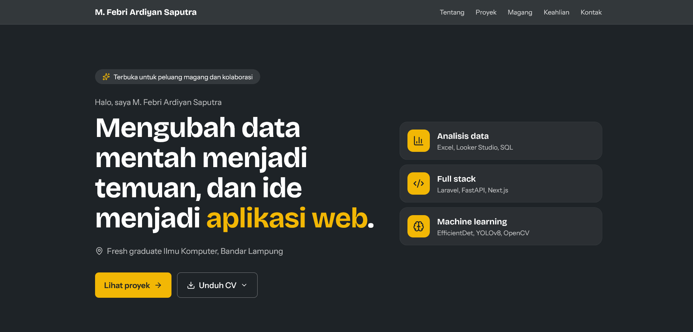

# Portofolio M. Febri Ardiyan Saputra

Portofolio pribadi saya sebagai lulusan S1 Ilmu Komputer Universitas Lampung (2022 sampai 2026) yang berfokus pada **analisis data** dan **pengembangan web**. Situs ini memuat proyek analisis data, aplikasi web, dan penelitian machine learning, lengkap dengan masalah, proses, hasil, rekomendasi, dan keterbatasannya.

**Situs:** https://febriardiyan.vercel.app/

<div align="center">
  
</div>


## Isi situs

- **Tentang saya**: profil singkat, pendidikan, dan fokus bidang.
- **Pengalaman**: magang di Dinas Tenaga Kerja Provinsi Lampung.
- **Proyek**: kartu proyek dengan filter kategori (Data analyst, Full stack, Machine learning) dan halaman detail per proyek.
- **Keahlian**: dikelompokkan per bidang.
- **Kontak**: email, LinkedIn, GitHub, dan unduhan CV (versi Data Analyst dan Web Developer).

## Proyek yang ditampilkan

| Proyek | Kategori | Ringkasan |
| --- | --- | --- |
| Analisis Ketenagakerjaan Provinsi Lampung 2022 sampai 2024 | Data analyst | Dashboard Looker Studio dan laporan 28 pertanyaan dari data Disnaker Provinsi Lampung, dipresentasikan kepada Bidang Perencanaan saat magang. |
| Analisis Churn Pelanggan Bank | Data analyst | Dashboard dan 6 insight dari dataset churn bank (10.000 pelanggan), lengkap dengan rekomendasi retensi. |
| SIDORA | Full stack | Sistem informasi surat menyurat dinas dengan persetujuan berjenjang (proyek tim, saya mengerjakan modul pegawai). |
| Deteksi Kerusakan Jalan dengan EfficientDet | Machine learning | Skripsi: perbandingan EfficientDet D0, D2, dan D3 pada dataset RDD2022. |
| Convert-app | Full stack | Aplikasi konversi dan pemindaian dokumen yang berjalan lokal. |

Setiap halaman detail proyek memuat: masalah, data dan metode, yang saya kerjakan, hasil, rekomendasi, galeri, dan keterbatasan.

## Teknologi

- [Next.js](https://nextjs.org) (App Router) dan [React](https://react.dev)
- [TypeScript](https://www.typescriptlang.org)
- [Tailwind CSS](https://tailwindcss.com) v4
- [lucide-react](https://lucide.dev) untuk ikon
- Dashboard dibuat di Google Looker Studio dan dilampirkan sebagai tautan serta screenshot

## Struktur folder

```
.
├── app/
│   ├── layout.tsx            # layout, font, metadata
│   ├── page.tsx              # halaman utama
│   └── projects/[slug]/      # halaman detail proyek
├── components/               # Hero, About, Experience, Projects, ProjectCard, Skills, Contact, dan lainnya
├── data/
│   ├── projects.ts           # semua konten proyek dan keahlian
│   └── cv.ts                 # daftar file CV
└── public/
    ├── images/               # screenshot dashboard dan aplikasi
    ├── laporan/              # laporan ringkas dalam PDF
    └── cv-*.pdf              # CV (Data Analyst dan Web Developer)
```

## Menjalankan di komputer sendiri

Prasyarat: Node.js 20 atau lebih baru.

```bash
# 1. Clone repositori
git clone GANTI-dengan-URL-repositori
cd portofolio

# 2. Pasang dependensi
npm install

# 3. Jalankan mode pengembangan
npm run dev
```

Buka [http://localhost:3000](http://localhost:3000) di browser.

Perintah lain:

```bash
npm run build   # build untuk produksi
npm run start   # jalankan hasil build
npm run lint    # cek kode dengan ESLint
```

## Mengubah konten

- **Proyek dan keahlian**: edit `data/projects.ts`. Satu proyek terdiri dari data dasar (judul, ringkasan, peran, masalah, hasil, dan seterusnya) dan data kartu (kategori, statistik, gambar sampul).
- **CV**: taruh file PDF di `public/`, lalu daftarkan di `data/cv.ts`.
- **Gambar**: simpan di `public/images/`. Gunakan nama file huruf kecil tanpa spasi dan samakan persis dengan yang ditulis di `projects.ts`, karena Linux dan Vercel membedakan huruf besar dan kecil.
- **Laporan PDF**: simpan di `public/laporan/`.

## Deployment

Situs dapat dideploy ke [Vercel](https://vercel.com): impor repositori dari GitHub, lalu Vercel akan menjalankan `npm run build` secara otomatis. Tidak ada variabel lingkungan yang diperlukan.

## Catatan data

- Data ketenagakerjaan bersumber dari Buku Data Ketenagakerjaan Provinsi Lampung (Disnaker Provinsi Lampung, posisi 31 Januari 2025).
- Dataset churn bank berasal dari Kaggle.
- Skripsi memakai dataset sekunder RDD2022. Kode penelitian ada di repositori terpisah.
- Seluruh analisis bersifat deskriptif. Keterbatasan masing-masing proyek dijelaskan di halaman detailnya.

## Kontak

- Email: mfebriardiyansaputra@gmail.com
- LinkedIn: [m-febri-ardiyan-saputra](https://www.linkedin.com/in/m-febri-ardiyan-saputra-923ba1434)
- GitHub: [MuhammadFebriArdiyanSaputra](https://github.com/MuhammadFebriArdiyanSaputra)